# Lab 01 - Small enterprise Network Firewall

## 1. Overview

This lab simulates a small enterprise network in Cisco Packet Tracer. The objective is to implement a basic network security policies using Extended Access List (ACLs) and Network Address Translation (NAT/PAT).

**The network is divided into 3 zones**

- INSIDE: The internal network
- OUTSIDE: The external network
- DMZ: A separate network hosting a web server

**Objectives**

- Configure ip addressing and traffic routing
- Implement ACLs to control traffic between zones
- Configure NAT/PAT for internal network
- Test allowed and denied traffic using Simulation mode
- Troubleshoot connectivity issues by inspecting packet headers and ACL matches

**Tools and technologies**

- Cisco Packet Tracer
- Extended ACL
- Static routing
- NAT/PAT
- TCP/IP, HTTP, HTTPS

## 2. Topology

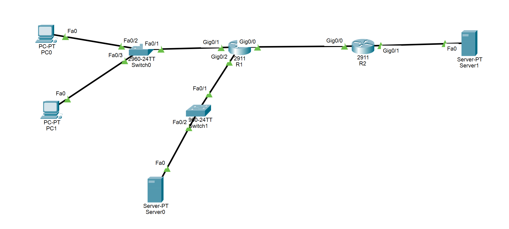

| **Device** | **Role**                |
| ---------- | ----------------------- |
| R1         | Edge router             |
| R2         | Simulated ISP router    |
| PC0/PC1    | Internal client devices |
| Server0    | DMZ web server          |
| Server1    | External web server     |

## 3. IP Addressing & Routing

The network consists of three security zones connected through R1, which acts as the edge router and enforces traffic filtering policies.
| **Device** | **Interface** | **IP Address**| **Description** |
|------------|---------------|---------------|-----------------|
| R1 | G0/0 | 203.0.113.2/30 | OUTSIDE|
| R1 | G0/1 | 192.168.10.1/24 | INSIDE|
| R1 | G0/2 | 192.168.20.1/24 | DMZ|
| R2 | G0/0 | 203.0.113.1/30 | ISP-facing link|
| R2 | G0/1 | 192.168.30.1/24 | External network|
| PC0 | NIC | 192.168.10.10/24 | Internal client|
| PC1 | NIC | 192.168.10.11/24 | Internal client|
| Server0 | NIC | 192.168.20.10/24 | DMZ web server|
| Server1 | NIC | 192.168.30.10/24 | External web server|

**Routing**

R1 uses a default route pointing towards R2 which simulates an ISP router.\
R2 provides connectivity to external networks.\
Static routing is used to establish connectivity between networks before applying security policies.

## 4. Security policies

| **Source** | **Destination** | **Policy**                       |
| ---------- | --------------- | -------------------------------- |
| INSIDE     | OUTSIDE         | Allow HTTP, HTTPS, DNS           |
| INSIDE     | DMZ             | Allow HTTP, HTTPS                |
| OUTSIDE    | INSIDE          | Deny unsolicited connections     |
| OUTSIDE    | DMZ             | Allow HTTP, HTTPS                |
| DMZ        | INSIDE          | Deny unsolicited connections     |
| DMZ        | OUTSIDE         | Allow HTTP, HTTPS return traffic |

## 5. Implementation

### 5.1 Interface Configuration

R1 serves as the edge router connecting three separated zones: INSIDE, OUTSIDE, DMZ.\
Each zone is associated with a dedicated physical interface.

```
interface g0/0
    description OUTSIDE
    ip address 203.0.113.2 255.255.255.252
    no shutdown

interface g0/1
    description INSIDE
    ip address 192.168.10.1 255.255.255.0
    no shutdown

interface g0/2
    description DMZ
    ip address 192.168.20.1 255.255.255.0
    no shutdown
```

G0/0 connects R1 to the simulated ISP router.\
G0/1 connects R1 to the internal network.\
G0/2 connects R1 to the DMZ hosting the web server.\
**Traffic filtering is implemented using Extended Access List applied to these interfaces.**

### 5.2 Routing Configuration

R1 - Default Route

```
ip route 0.0.0.0 0.0.0.0 203.0.113.1
```

This command ensures the R1 forwards packet to unknown networks through R2 - The simulated ISP router.

R2 - Return Route

```
ip route 192.168.10.0 255.255.255.0 203.0.113.2
ip route 192.168.20.0 255.255.255.0 203.0.113.2
```

Verification

```
show ip route
```

Routing must be configured correctly before troubleshooting connectivity problems related to ACLs or NAT.

### 5.3 NAT/PAT Configuration

Network Address Translation (NAT) is configured on R1 to translate addresses between the internal and external networks. Port Address Translation (PAT) allow multiple devices to share R1's outside IP address.

```cisco
interface g0/1
    ip nat inside

interface g0/0
    ip nat outside

ip nat inside source list 1 interface g0/0 nat overload
access-list 1 permit 192.168.10.0 0.0.0.255
```

The standard ACL here selects addresses eligible for translation.

**Packet flow example**
| **Stage** | **Source** | **Destination** |
|-----------|------------|-----------------|
|Before PAT | 192.168.10.10:100| 192.168.20.10:80|
|After PAT | 203.0.113.2:100 | 192.168.20.10:80|
|Server response| 192.168.20.10:80 | 203.0.113.2:100|
|After reverse PAT| 192.168.20.10:80 | 192.168.10.10:100

### 5.4 Extended ACL Configuration

#### 5.4.1 INSIDE-IN

The INSIDE-IN ACL controls traffic originating from the internal network. It permits authorized services while restricting access to unauthorized destinations and ports.

```cisco
ip access-list extended INSIDE-IN
    permit tcp 192.168.10.0 0.0.0.255 host 192.168.20.10 eq 80
    permit tcp 192.168.10.0 0.0.0.255 host 192.168.20.10 eq 443
    deny ip 192.168.10.0 0.0.0.255 192.168.20.0 0.0.0.255
    permit tcp 192.168.10.0 0.0.0.255 any eq 80
    permit tcp 192.168.10.0 0.0.0.255 any eq 443
    permit tcp 192.168.10.0 0.0.0.255 any eq 53
    permit udp 192.168.10.0 0.0.0.255 any eq 53

interface G0/1
    ip access-group INSIDE-IN in
```

**The explicit DMZ deny rule is placed before the general outbound permit rules to prevent unauthorized access to other DMZ devices and services.**

**INSIDE -> DMZ (192.168.10.0/24 -> 192.168.20.0/24)**

- Internal clients can only access the server on TCP port 80 and 443
- Internal clients can't access other devices/services in 192.168.20.0/24

**INSIDE -> OUTSIDE (192.168.10.0/24 -> 0.0.0.0/0)**

- Only permit HTTP, HTTPS and DNS traffic

**Example flow**\
PC0 (192.168.10.10) -> DMZ web server (192.168.20.10)

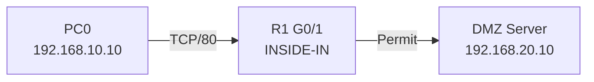

The packet enters R1 at interface G0/1, it then gets evaluated and pass through the first rule. The packet enters into the DMZ server and then get processed.

#### 5.3.2 DMZ-IN

The DMZ-IN ACL restricts traffic originating from the DMZ network. It prevents devices in the DMZ from initiating unauthorized connections to other security zones while permitting return traffic for established TCP connections.

```cisco
ip access-list extended DMZ-IN
    permit tcp host 192.168.20.10 eq 80 192.168.10.0 0.0.0.255 established
    permit tcp host 192.168.20.10 eq 443 192.168.10.0 0.0.0.255 established
    permit tcp host 192.168.20.10 eq 80 any established
    permit tcp host 192.168.20.10 eq 443 any established
    deny ip 192.168.20.0 0.0.0.255 any

interface G0/2
    ip access-group DMZ-IN in
```

**DMZ -> INSIDE (192.168.20.0/24 -> 192.168.10.0/24)**

- Only return traffic from the DMZ web server at TCP port 80 and 443 with the ack flag on
- Other traffic originating from the DMZ network is denied

**DMZ -> OUTSIDE (192.168.20.0/24 -> 0.0.0.0/0)**

- Only return traffic from the DMZ web server at TCP port 80 and 443 with the ack flag on
- Other traffic originating from the DMZ network is denied

**Example flow**

1. PC0 (192.168.10.10) -> DMZ web server (192.168.20.10)
2. DMZ web server (192.168.20.10) -> PC0 (192.168.10.10)


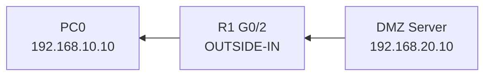

After receiving the TCP connection request from PC0, the DMZ web server generates a response packet with the SYN and ACK flags set.

The response enters R1 through interface G0/2, where the inbound DMZ-IN ACL evaluates it. Since the packet originates from TCP port 80 and has the ACK flag set, it matches the first permit rule.

R1 then forwards the packet toward PC0 through G0/1.

#### 5.3.3 OUTSIDE-IN

The OUTSIDE-IN ACL filter traffic originating from the external network through R1 interface G0/0. Only return traffic on port 80 and 443 with the ACK flag turned on is allowed to pass through, other traffic is denied.

```cisco
ip access-list extended OUTSIDE-IN
    permit tcp any host 192.168.20.10 eq 80
    permit tcp any host 192.168.20.10 eq 443
    permit tcp any eq 80 host 203.0.113.2 established
    permit tcp any eq 443 host 203.0.113.2 established
    deny ip any 192.168.10.0 0.0.0.255
    deny ip any 192.168.20.0 0.0.0.255

interface G0/0
    ip access-group OUTSIDE-IN in
```

**OUSTSIDE -> INSIDE (0.0.0.0/0 -> 192.168.10.0/24)**

- Allow return traffic on TCP port 80, 443 with the flag ACK turned on to pass through R1's outside IP

**OUTSIDE -> DMZ (0.0.0.0/0 -> 192.168.20.0/24)**

- External devices are allowed to access the DMZ web server on TCP port 80, 443

**Example flow**

1. PC0 (192.168.10.10) -> External web server (192.168.30.10)
2. External web server (192.168.30.10) -> PC0 (192.168.10.10)

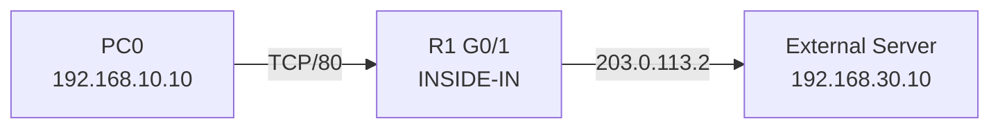

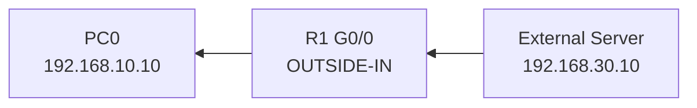

After receiving the TCP connection request from PC0, the External web server generates a response packet with the SYN and ACK flags set.

The response enters R1 through interface G0/0, where the inbound OUTSIDE-IN ACL evaluates it. Since the packet originates from TCP port 80 and has the ACK flag set, it matches the third permit rule.

R1 then forwards the packet toward PC0 through G0/1.

## 6. Testing and Verification

### 6.1 Test Cases

| **Test**                | **Expected result** |
| ----------------------- | ------------------- |
| INSIDE -> DMZ HTTP      | permit              |
| INSIDE -> DMZ HTTPS     | permit              |
| INSIDE -> DMZ ICMP      | deny                |
| INSIDE -> OUTSIDE HTTP  | permit              |
| INSIDE -> OUTSIDE HTTPS | permit              |
| INSIDE -> OUTSIDE ICMP  | deny                |

### 6.2 Verification commands

**Show access lists configured in R1**

```cisco
enable
show access-list
```

**Show NAT translations**

```cisco
enable
show ip nat translations
```

**Show interface configured access-list**

```cisco
enable
show ip interface g0/0 | include access list
show ip interface g0/1 | include access list
show ip interface g0/2 | include access list
```

## 7 Troubleshooting

## 7.1 Problem description

During connectivity testing, an internal client was unable to access the outside web server despite having correct IP addressing and routing configurations.

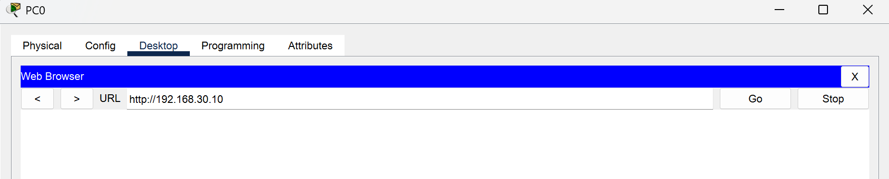

## 7.2 Investigation

1. Check the Routing table
   Ensures that the route is properly configured for packet to flow

R1 Routes:
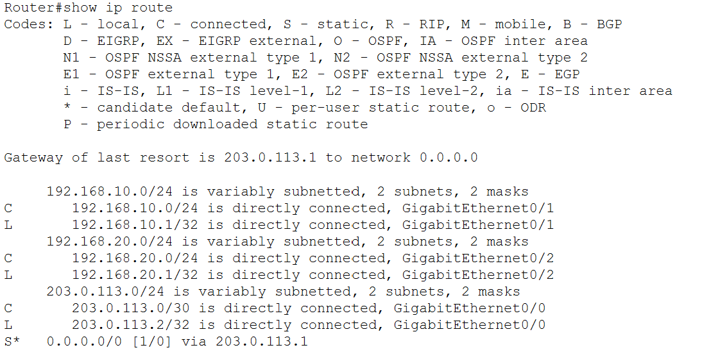

R2 Routes:
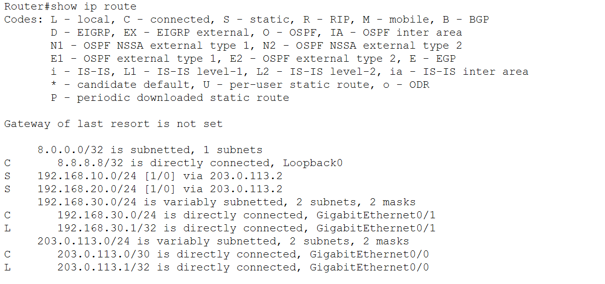

The routing is properly configured

2. Inspect the packet flow from INSIDE to OUTSIDE

Used Packet Tracer Simulation Mode

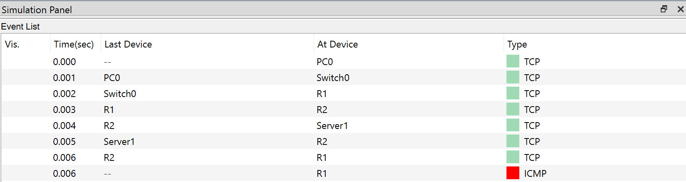

Here we can see that the packet successfully sent to the External web server, but got drop out by Router1. Inspect the packet at Router 1

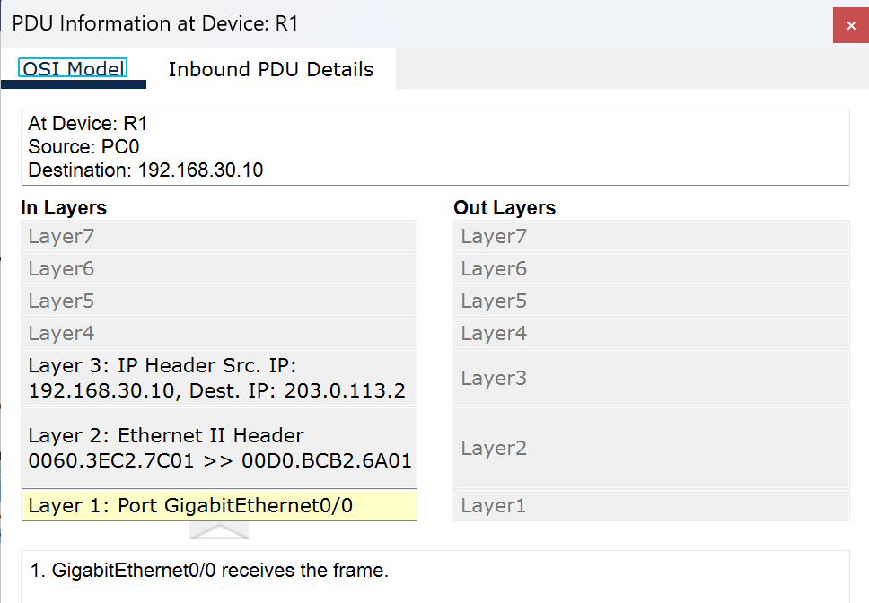
**Dest.IP 203.0.113.2**\
=> This is the root cause

Our access-list originally had:
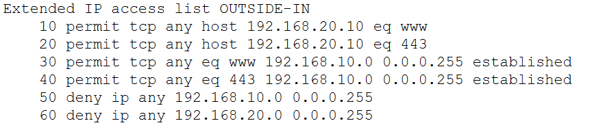

The Destination IP 203.0.113.2 doesn't match any permit rules so the packet got denied and dropped by R1\
This is caused by Port Address Translation (PAT) that we configured.

## 7.3 Solution

```cisco
ip access-list extended OUTSIDE-IN
    no 30
    no 40
    30 permit tcp any eq 80 host 203.0.113.2 established
    40 permit tcp any eq 443 host 203.0.113.2 established
```

Now the Destination IP is matched ensures that the return traffic can pass through R1

## 7.4 Verifications

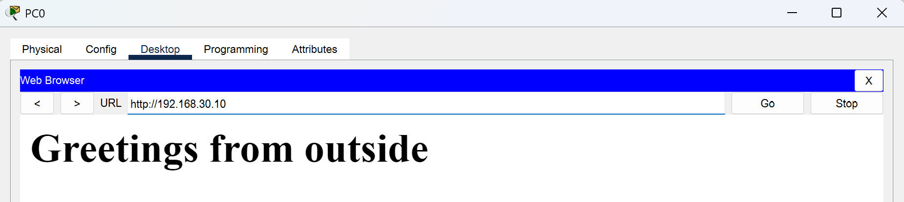

## 8. Conclusions

### What I accomplished

From this lab i managed to implement a small enterprise network with enforced firewall to secure the network. I learned how to configure ACLs to act as a firewall to protect the network, the PAT to translate the addresses.

### Key Takeaways

This lab improved my understanding of how ACLs and NAT/PAT interact when processing network traffic.\
This helps me strengthen my fundementals.

### Limitations and Future Improvements

From this lab, i noticed that:

- Traditional ACLs don't provide true stateful connection tracking.
- Public HTTP/HTTPS port forwarding to the DMZ server wasn't implemented.
- More advanced firewall capabilities remain outside the scope of this lab.
