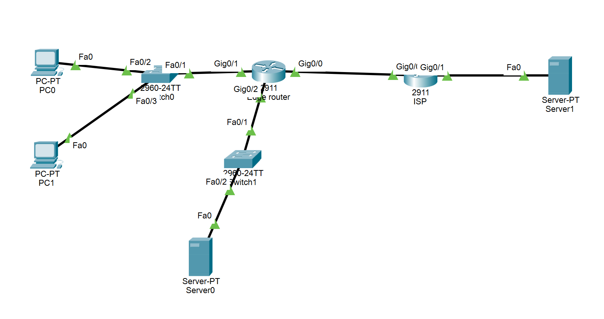
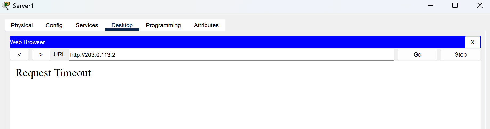
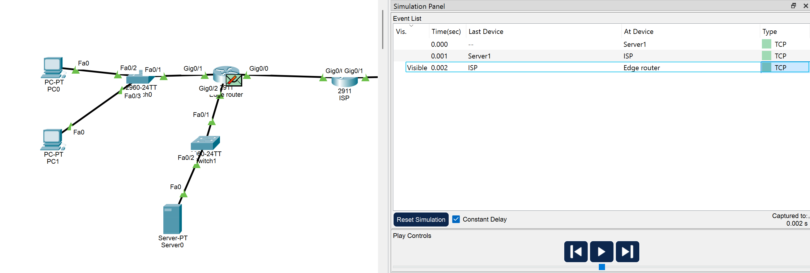
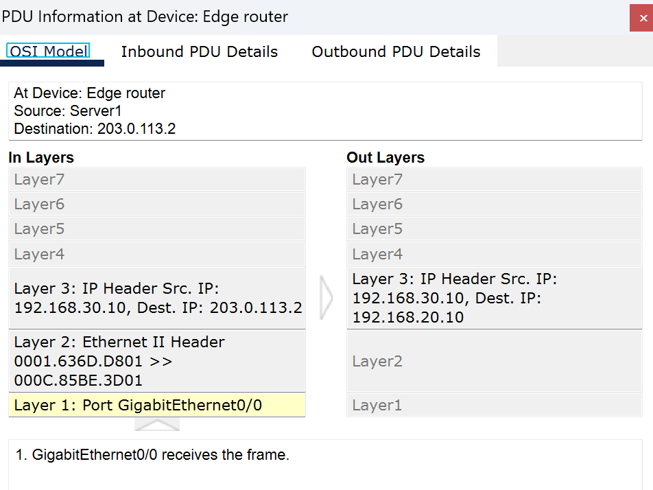
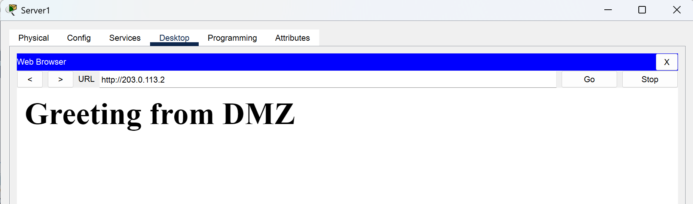

# Lab 02 - Small enterprise Zone Based Firewall

## 1. Overview

This lab simulates a small enterprise network in Cisco Packet Tracer. The objective is to implement a basic network security policies using Zone Based Firewall (ZBF) and Network Address Translation (NAT).

**The network is divided into three zones**

- INSIDE: The internal network
- OUTSIDE: The external network
- DMZ: A separate network hosting a web server

**Objectives**

- Configure IP addressing
- Implement ZBF to control traffic between zones
- Configure NAT/PAT for internal network
- Test allowed and denied traffic using simulation mode
- Troubleshoot connectivity by inspecting packet header

**Tools and technologies**

- Cisco Packet Tracer
- Extended ACL
- Static routing
- NAT/PAT
- TCP/IP, HTTP, HTTPS

## 2. Topology



| **Device** | **Role**                |
| ---------- | ----------------------- |
| R1         | Edge router             |
| R2         | Simulated ISP router    |
| PC0/PC1    | Internal client devices |
| Server0    | DMZ web server          |
| Server1    | External web server     |

## 3. IP Addressing & Routing

The network consists of three security zones connected through R1, which acts as the edge router and enforces traffic filtering policies.
| **Device** | **Interface** | **IP Address**| **Description** |
|------------|---------------|---------------|-----------------|
| R1 | G0/0 | 203.0.113.2/30 | OUTSIDE|
| R1 | G0/1 | 192.168.10.1/24 | INSIDE|
| R1 | G0/2 | 192.168.20.1/24 | DMZ|
| R2 | G0/0 | 203.0.113.1/30 | ISP-facing link|
| R2 | G0/1 | 192.168.30.1/24 | External network|
| PC0 | NIC | 192.168.10.10/24 | Internal client|
| PC1 | NIC | 192.168.10.11/24 | Internal client|
| Server0 | NIC | 192.168.20.10/24 | DMZ web server|
| Server1 | NIC | 192.168.30.10/24 | External web server|

**Routing**

R1 uses a default route pointing towards R2 which simulates an ISP router.\
R2 provides connectivity to external networks.\
Static routing is used to establish connectivity between networks before applying security policies.

## 4. Security policies

| **Source** | **Destination** | **Policy**                       |
| ---------- | --------------- | -------------------------------- |
| INSIDE     | OUTSIDE         | Allow HTTP, HTTPS, DNS           |
| INSIDE     | DMZ             | Allow HTTP, HTTPS                |
| OUTSIDE    | INSIDE          | Deny unsolicited connections     |
| OUTSIDE    | DMZ             | Allow HTTP, HTTPS                |
| DMZ        | INSIDE          | Deny unsolicited connections     |
| DMZ        | OUTSIDE         | Allow HTTP, HTTPS return traffic |

## 5. Implementation

### 5.1 Security Zone Configuration

**Check whether or not the security license is activated**

```cisco
enable
configure terminal
zone security [NAME]
```

**If the security license isn't activated**

```cisco
enable
configure terminal
license boot module [ROUTER] technology-package securityk9
exit
write
reload
```

#### Create Security Zone

```cisco
enable
configure terminal

zone security INSIDE
exit

zone security OUTSIDE
exit

zone security DMZ
exit
```

#### Interface Configuration

**Configure Interface's IP Addressing**

- G0/0 connects R1 to the simulated ISP router.
- G0/1 connects R1 to the internal network.
- G0/2 connects R1 to the DMZ hosting the web server.

```cisco
interface g0/0
    description OUTSIDE
    ip address 203.0.113.2 255.255.255.252
    no shutdown

interface g0/1
    description INSIDE
    ip address 192.168.10.1 255.255.255.0
    no shutdown

interface g0/2
    description DMZ
    ip address 192.168.20.1 255.255.255.0
    no shutdown
```

**Assign Zones**\
R1 connects three separated zones: INSIDE, OUTSIDE, DMZ.\
Each zone is dedicated to one physical interface.

```cisco
interface g0/0
    zone-member security OUTSIDE

interface g0/1
    zone-member security INSIDE

interface g0/2
    zone-member security DMZ
```

### 5.2 Routing Configuration

**R1 - Default Route**

```
ip route 0.0.0.0 0.0.0.0 203.0.113.1
```

This command ensures the R1 forwards packet to unknown networks through R2 - The simulated ISP router.

**R2 - Return Route**

```
ip route 192.168.10.0 255.255.255.0 203.0.113.2
ip route 192.168.20.0 255.255.255.0 203.0.113.2
```

**Verification**

```
show ip route
```

### 5.3 NAT/PAT Configuration

Network Address Translation (NAT) is configured on R1 to translate addresses between the internal and external networks. Port Address Translation (PAT) allow multiple devices to share R1's outside IP address.

```cisco
interface g0/1
    ip nat inside

interface g0/2
    ip nat inside

interface g0/0
    ip nat outside

ip nat inside source list 1 interface g0/0 nat overload
access-list 1 permit 192.168.10.0 0.0.0.255
access-list 1 permit 192.168.20.0 0.0.0.255
```

**Port Forwarding**

Port forwarding is configured to make the DMZ web server (192.168.20.10) accessible to external clients through the router's public IPv4 address (203.0.113.2), without directly exposing the server's private IP address.

```cisco
ip nat inside source static tcp 192.168.20.10 80 203.0.113.2 80
```

This translates incoming TCP connections destined for 203.0.113.2 on port 80 to the DMZ web server at 192.168.20.10 on port 80.

### 5.4 Security Policy Configuration

The Zone-Based Firewall (ZBF) controls traffic between security zones using zone-pair policies. Each policy defines which traffic is permitted, inspected, or dropped when traversing from a source zone to a destination zone.

**Policies configuration consists of 3 main stages**

- Traffic classification: Define class-map to indentify traffic based on protocols or access control lists (ACLs).
- Policy defination: Create policy-map that specify the action applied to matching traffic: inspect, drop or pass.
- Policy application: Create zone-pairs and attach the policy-maps using service-policy.

**Zone-pairs are directional**. For example, a policy applied to INSIDE → OUTSIDE does not automatically permit new connections initiated from OUTSIDE → INSIDE. However, traffic inspected by a stateful policy can allow corresponding return traffic without a reverse zone-pair policy.

#### 5.4.1 INSIDE-OUTSIDE

**Traffic policy**
| **Protocol** | **Action** |
|--------------|------------|
| HTTP | Inspect |
| HTTPS| Inpsect |
| DNS | Inspect |
| Other unmatched traffic | Drop |

**Configuration**

**Class-Map configuration**

```cisco
class-map type inspect match-any CM-INSIDE-OUTSIDE
    match http
    match https
    match dns
```

We use match-any so that when any of the protocol matches, that traffic is classified.

**Policy-Map configuration**

- Create a policy-map

```cisco
policy-map type inspect PM-INSIDE-OUTSIDE
```

- Specify a class type inspect and reference the class-map

```cisco
class type inspect CM-INSIDE-OUTSIDE
```

- Specify the action for the class-map

```cisco
inspect
```

The inspect command allows for stateful tracking, other commands are pass, drop.\
Use exit command twice to return to config mode.

**Policy application**

- Create a zone-pair and specify the source and the destination

```cisco
zone-pair security ZP-INSIDE-OUTSIDE source INSIDE desination OUTSIDE
```

- Reference the policy-map for handling traffic between two zones

```cisco
service-policy type inspect PM-INSIDE-OUTSIDE
```

#### 5.4.2 INSIDE-DMZ

**Traffic policy**
| **Protocol** | **Action** |
|--------------|------------|
| HTTP | Inspect |
| HTTPS| Inpsect |
| Other unmatched traffic | Drop |

**Configuration**

The zone-pair INSIDE-DMZ only allows clients from the internal network to gain access to the DMZ web server.

**Class-Map configuration**

```cisco
ip access-list extended ACL-INSIDE-DMZ
    permit tcp 192.168.10.0 0.0.0.255 host 192.168.20.10 eq 80
    permit tcp 192.168.10.0 0.0.0.255 host 192.168.20.10 eq 443

class-map type inspect match-any CM-INSIDE-DMZ
    match access-group name ACL-INSIDE-DMZ
```

We use match-any so that when any of the protocol matches, that traffic is classified.

**Policy-Map configuration**

- Create a policy-map

```cisco
policy-map type inspect PM-INSIDE-DMZ
```

- Specify a class type inspect and reference the class-map

```cisco
class type inspect CM-INSIDE-DMZ
```

- Specify the action for the class-map

```cisco
inspect
```

The inspect command allows for stateful tracking, other commands are pass, drop.\
Use exit command twice to return to config mode.

**Policy application**

- Create a zone-pair and specify the source and the destination

```cisco
zone-pair security ZP-INSIDE-DMZ source INSIDE desination DMZ
```

- Reference the policy-map for handling traffic between two zones

```cisco
service-policy type inspect PM-INSIDE-DMZ
```

#### 5.4.3 OUTSIDE-DMZ

**Traffic policy**
| **Protocol** | **Action** |
|--------------|------------|
| HTTP | Inspect |
| HTTPS| Inpsect |
| Other unmatched traffic | Drop |

**Configuration**

The zone-pair OUTSIDE-DMZ only allows clients from the external network to gain access to the DMZ web server.

**Class-Map configuration**

```cisco
ip access-list extended ACL-OUTSIDE-DMZ
    permit tcp any host 192.168.20.10 eq 80
    permit tcp any host 192.168.20.10 eq 443

class-map type inspect match-any CM-OUTSIDE-DMZ
    match access-group name ACL-OUTSIDE-DMZ
```

We use match-any so that when any of the protocol matches, that traffic is classified.

**Policy-Map configuration**

- Create a policy-map

```cisco
policy-map type inspect PM-OUTSIDE-DMZ
```

- Specify a class type inspect and reference the class-map

```cisco
class type inspect CM-OUTSIDE-DMZ
```

- Specify the action for the class-map

```cisco
inspect
```

The inspect command allows for stateful tracking, other commands are pass, drop.\
Use exit command twice to return to config mode.

**Policy application**

- Create a zone-pair and specify the source and the destination

```cisco
zone-pair security ZP-OUTSIDE-DMZ source OUTSIDE desination DMZ
```

- Reference the policy-map for handling traffic between two zones

```cisco
service-policy type inspect PM-OUTSIDE-DMZ
```

#### 5.4.4 DMZ-OUTSIDE

**Traffic policy**
| **Protocol** | **Action** |
|--------------|------------|
| HTTP | Inspect |
| HTTPS| Inpsect |
| DNS | Inspect |
| Other unmatched traffic | Drop |

**Configuration**

**Class-Map configuration**

```cisco
ip access-list extended ACL-DMZ-OUTSIDE
    permit tcp host 203.0.113.2 any eq 80
    permit tcp host 203.0.113.2 any eq 443
    permit tcp host 203.0.113.2 any eq 53
    permit udp host 203.0.113.2 any eq 53

class-map type inspect match-any CM-DMZ-OUTSIDE
    match access-group name ACL-DMZ-OUTSIDE
```

We use match-any so that when any of the protocol matches, that traffic is classified.

**Policy-Map configuration**

- Create a policy-map

```cisco
policy-map type inspect PM-DMZ-OUTSIDE
```

- Specify a class type inspect and reference the class-map

```cisco
class type inspect CM-DMZ-OUTSIDE
```

- Specify the action for the class-map

```cisco
inspect
```

The inspect command allows for stateful tracking, other commands are pass, drop.\
Use exit command twice to return to config mode.

**Policy application**

- Create a zone-pair and specify the source and the destination

```cisco
zone-pair security ZP-DMZ-OUTSIDE source DMZ desination OUTSIDE
```

- Reference the policy-map for handling traffic between two zones

```cisco
service-policy type inspect PM-DMZ-OUTSIDE
```

#### 5.4.5 OUTSIDE-INSIDE

By default if there's no zone pair between two zones, then these zones can't communicate with each other, so we will not configure this pair.

#### 5.4.6 DMZ-INSIDE

By default if there's no zone pair between two zones, then these zones can't communicate with each other, so we will not configure this pair.

## 6. Testing and Verification

### 6.1 Test Cases

| **Test**                | **Expected result** |
| ----------------------- | ------------------- |
| INSIDE -> DMZ HTTP      | permit              |
| INSIDE -> DMZ HTTPS     | permit              |
| INSIDE -> DMZ ICMP      | deny                |
| INSIDE -> OUTSIDE HTTP  | permit              |
| INSIDE -> OUTSIDE HTTPS | permit              |
| INSIDE -> OUTSIDE ICMP  | deny                |

### 6.2 Verification commands

**Show access lists configured in R1**

```cisco
enable
show access-list
```

**Show zones and their members**

```cisco
enable
show zone security
```

**Show zone-pairs and their service policy**

```cisco
enable
show zone-pair security
```

**Show NAT translations**

```cisco
enable
show ip nat translations
```

## 7. Troubleshooting

### NAT and Zone-Based Firewall interaction

**Problem**

During firewall testing, HTTP requests from the OUTSIDE network to the DMZ web server were dropped at R1, even though a static PAT rule and a corresponding Zone-Based Firewall policy had been configured.



**Investigation**

The original ACL referenced by the ZBF class map matched HTTP traffic destined for the router's public IP address (203.0.113.2). However, Packet Tracer Simulation Mode showed that the traffic was not successfully forwarded to the DMZ server.





Original ACL

```cisco
permit tcp any host 203.0.113.2 eq 80
permit tcp any host 203.0.113.2 eq 443
```

**Solution**

The ACL destination was changed from the public IP address (203.0.113.2) to the DMZ server's private IP address (192.168.20.10). After this modification, the HTTP connection succeeded.

```cisco
no permit tcp any host 203.0.113.2 eq 80
no permit tcp any host 203.0.113.2 eq 443

permit tcp any host 192.168.20.10 eq 80
permit tcp any host 192.168.20.10 eq 443
```

### Verification



**Explanation**

The results suggest that the ZBF class map evaluated the destination address after static PAT translation. Therefore, the ACL needed to match the translated private destination address rather than the original public address.

A similar observation was made during DMZ to OUTSIDE testing, where matching the translated source address allowed the connection.

## 8. Conclusions

### What I accomplished

From this lab i managed to implement a small enterprise network with enforced firewall to secure the network. I learned how to implement Zone-Based Firewall to protect the network.

### Key Takeaways

The lab highlighted the differences between traditional ACL-based filtering and stateful firewall inspection. Unlike stateless ACLs, ZBF can automatically permit return traffic for inspected sessions without requiring separate reverse-direction policies. Additionally, troubleshooting NAT and ZBF interactions provided practical experience in understanding how address translation can affect firewall traffic classification.

### Future Improvements

Future improvements could include implementing more granular access policies, introducing centralized logging and monitoring, and testing additional attack scenarios to evaluate the firewall's effectiveness under different conditions.
